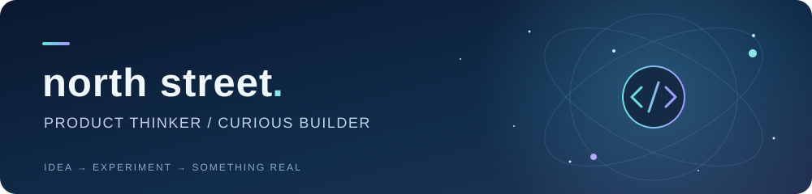
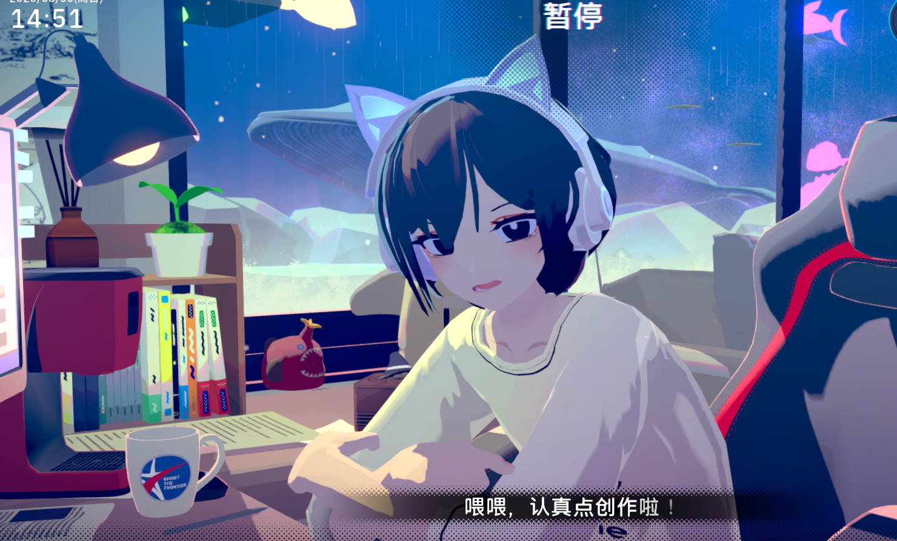
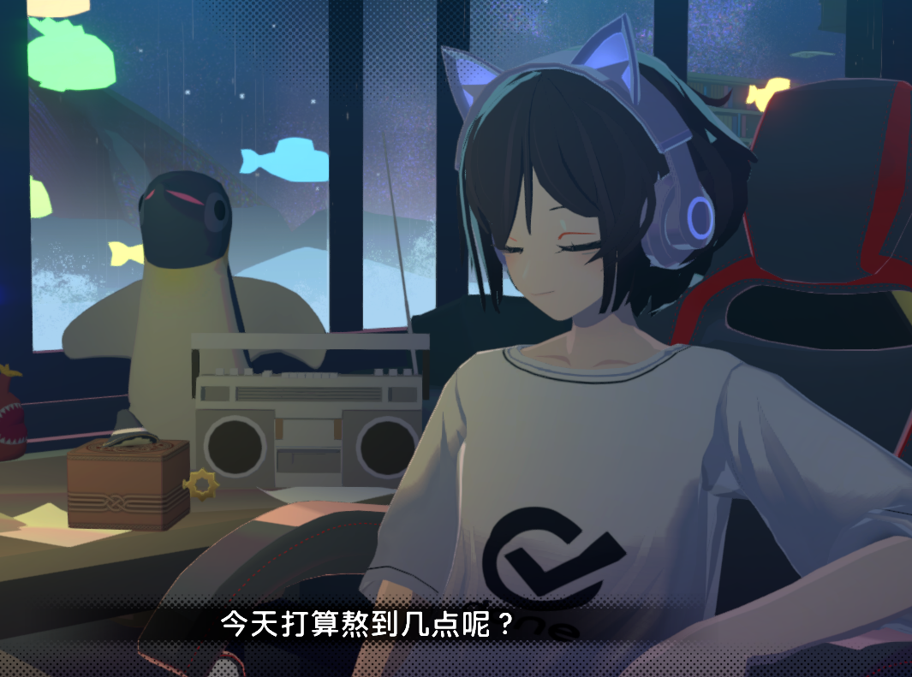
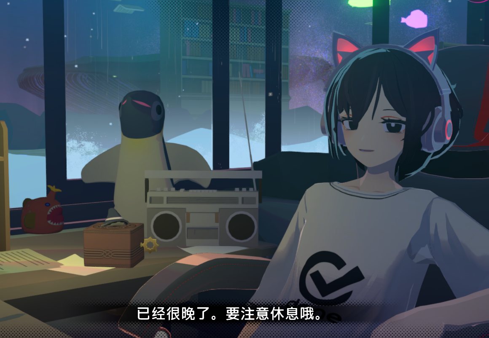
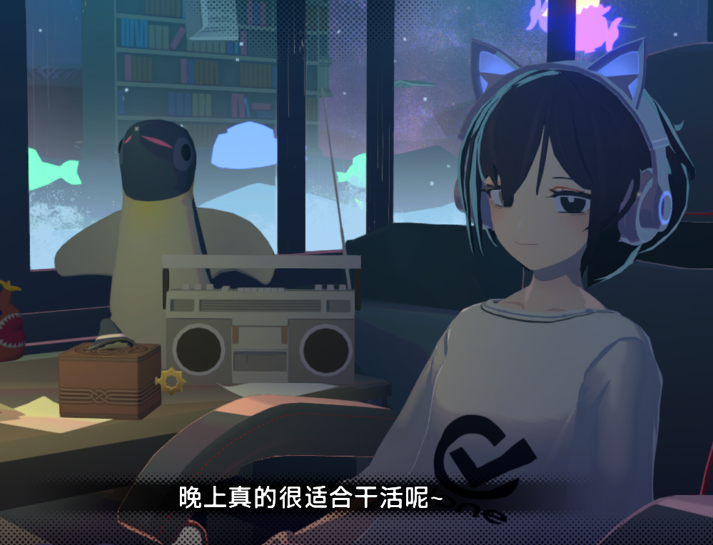

  

  <b>本职产品经理 · 因为喜欢编程，开始自己写代码</b>

  喜欢琢磨产品，也享受亲手把想法做出来的过程。 
  从一个念头到一次尝试，边学边做，慢慢完善。

  <a href="https://github.com/northstreet01/pokerogue-early">🎮 正在做的项目</a>
  &nbsp; · &nbsp;
  <a href="https://northstreet01.github.io">📝 我的博客</a>
  &nbsp; · &nbsp;
  <a href="https://github.com/northstreet01?tab=repositories">🧩 更多尝试</a>

 

  

## 🛠️ 把想法变成可以体验的东西

<table>
  <tr>
    <td width="58%" valign="top">
      <h3>🎮 PokéRogue Early</h3>
      
基于 PokéRogue 早期版本进行修改，保留单人游戏与本地存档，逐步探索双人合作玩法。

      
<code>TypeScript</code> <code>游戏改造</code> <code>开发中</code>

      <a href="https://github.com/northstreet01/pokerogue-early">查看项目 →</a>
    </td>
    <td width="42%" valign="top">
      <h3>📝 学习，也留下记录</h3>
      
在博客里记录学习、实践和想法，让做过的尝试、遇到的问题都有迹可循。

      
<code>学习记录</code> <code>实践笔记</code>

      <a href="https://northstreet01.github.io">去博客看看 →</a>
    </td>
  </tr>
</table>

## 🎧 聪音 · 我特别喜欢的角色

她是《放松时光：与你共享Lo-Fi故事》里的聪音（Satone）。 我特别喜欢她，所以也想在自己的主页上，留一个属于她的小角落。

<table>
  <tr>
    <td align="center" width="33%"></td>
    <td align="center" width="33%"></td>
    <td align="center" width="33%"></td>
  </tr>
</table>

聪音（Satone） · 游戏截图来自 <a href="https://store.steampowered.com/app/3548580/?l=schinese">《放松时光：与你共享Lo-Fi故事》</a>

 

  <b>把感兴趣的事情，慢慢变成现实。</b> 
  Stay curious. Keep building.

